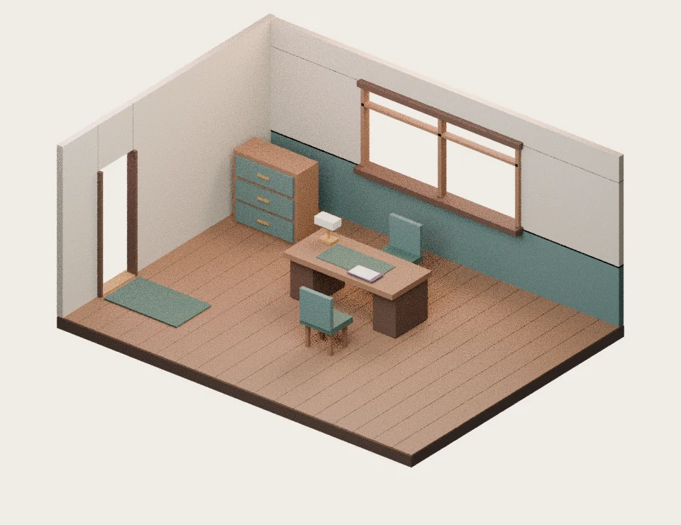

# One Last Crossing · Where the six stories happen

Week 11 • Founder location interview and Inklings writing workshop • November 22, 2026

Jake selected where the first five encounters take place. For the sixth he selected Dr. Duckhook’s executive office and the reason for the meeting. David Babb comes to buy the golf course for The LLC’s investment portfolio. Zach Wilson refuses his offers. Jake asked the Inklings to develop the scene before choosing the spot where Zach delivers his final answer. Dialogue, props and cuts below are proposed manuscript. The Week 11 football outcomes still control the sporting endings.

Three modeled workshop desks developed this pass. The first tested whose decision changes each scene, the second wrote the Jackson negotiation, and the third tested whether the place and its people remain recognizable across cuts. Their editorial choices below build on the [previous individual council notes](SIX_LOCATION_SUMMIT_SEAT_NOTES_2026-11-22.md), [six venue dossiers](SIX_MATCHUP_ATLAS_SUMMIT_2026-11-22.md) and [Week 10 physical page crosswalk](https://github.com/jakekaloper-hub/schemin-26/blob/51834dd03d8ccd182e11ca41fab71481a42afa7d/memo-os/week-10/production-evidence/completed-pdf-20261121/WEEK10_COMPLETED_PDF_RECEIPT_V1.json).

## Atlas addresses for production

All six sites use the existing Atlas location and sublocation resolver. The fixed landmark anchors the scene. The truck cab, spectators and temporary sporting equipment belong to the Week 11 staging. [Six scene records and three-layer notes](sets/location-bindings.json)

| Matchup | Parent venue | Feature within that venue |
|---|---|---|
| W11-G01 | `LOC-BRIDGE-MOUNTAIN-LAKE` | `STONE-BRIDGE` |
| W11-G02 | `LOC-SLOB-FOOTHILL-CAMP` | `HEARTHROAD-RUT` |
| W11-G03 | `LOC-TRADE-JEDI-MOUNTAIN-BASE` | `FOOT-OF-THE-EASTERN-ASCENT` |
| W11-G04 | `LOC-TDS-WATERFALL-TEMPLE` | `FALLS-VEGETATION-BREAK` |
| W11-G05 | `LOC-MUD-DOGS-SWAMP` | `GATORS-DAWGS-SIGN` |
| W11-G06 | `LOC-COUNTRY-CLUB-JACKSON` | `EXECUTIVE-OFFICE` |

The full address follows `SUB::<parent venue>::<feature>`. Use the existing stone bridge with midspan specified in the scene record. The executive office also has its own 3D study. The four other feature addresses are newly registered in this pass.

## Twelve seasons on six sets

Jake wants the places to feel as thoroughly inhabited as the world in *Red Dead Redemption 2*. The Commonwealth is playing its twelfth season. For Week 11, let the reader catch someone using each place in a way a first-time visitor would miss. Photograph that little piece of local knowledge in the pink, violet and aqua light of the GTA VI issue.

Read the study across each row. The six photographs are AI-generated art-direction proposals. Use them for materials, light and scale. Take the bridge’s width and lamp spacing from physical page 33, the swamp entrance from page 17, and the Jackson room layout from the office model. In the bridge master both lake edges must show. At the swamp gate the pictured insert is framed low enough to study the stands. The identifying wide must include the arched overhead board. [Finished Week 10 PDF receipt and physical-page crosswalk](https://github.com/jakekaloper-hub/schemin-26/blob/51834dd03d8ccd182e11ca41fab71481a42afa7d/memo-os/week-10/production-evidence/completed-pdf-20261121/WEEK10_COMPLETED_PDF_RECEIPT_V1.json)

**Mountain Lake Bridge.** Two wheel tracks polish the intact center stones. One reset stone catches the lantern because its face is still rough. Before Wilson and Austin meet, a carter waits back at the approach. Just before the duel, the last wheel across that stone gives a brief rattle. The waiting carter is the first to notice how long the lake stays quiet after the fall. Keep the same lantern beside it in the reverse. When Wilson fills the travelers’ usual line and Austin holds his place, even a reader who has never seen these two understands what everyone is waiting for.

**Hearthroad.** The road crew has packed pale gravel into the shoulder. The first white chip Jordan sees moving across the rut tells him the patch is washing out again. The audience learns the depth of the water by watching that chip. Jordan catches the curling delivery slip under the visor without taking his eyes off the windshield. Manning has been watching the water uphill. When Jordan turns back to the radio, stay at the windshield for one more sweep. Another chip goes. Match the sheltered kegs and canvas on physical page 35.

**Foot of the Eastern Ascent.** There’s a hollow in the path where people climbing with a load take the shorter inside turn. When a porter approaches, the uphill spectators open a gap without breaking off their conversation. Brandon, looking up at the crowd that laughed at him last week, mistakes the movement for a better view of himself. Then the parcel goes through. Let him have that private laugh. The damp path catches a low stripe of sky behind his hat. The residents close ranks again while Jake is still playing to them. Place any battle damage only where the Week 10 image supports the sightline.

**Waterfall Temple boundary.** The oldest clipped stems have gone grey. This week’s pale cuts are all on the path side, just wide enough for a person carrying something. A local with a basket pauses on the one dry stone to shift the load, then carries on. From farther back Kevin’s greeting disappears under the falls. When Phillip makes room for him on that stone, they can finally hear each other. Shoot toward the spray, with the visitors’ path visible and the household off camera. The opening works for either sport. Give the drying stone and the continued drip their own beat after the competitors leave.

**Gators & Dawgs sign.** The finished page 17 has empty raised stands on the left, flooded racing scars below, and a weathered overhead board reading **THE SWAMP DECLARES A BLOCKADE**. The small Cancún card hangs on the right post. Keep all four in their original relationship. Try one pale replacement plank low in the stands, where it would be stepped on first. Ben’s headlights catch a bright wet streak below it. Bobby walks the narrow, dull strip alongside the water and waits for Ben to notice where his paws stayed dry. Ben kills the high beams to see what Bobby sees. The postcard can still flutter when the truck goes quiet.

**Jackson executive office.** Staff borrow a course key from a brass hook beside the desk. The finish has worn through directly below it. In the minute before David opens his folio, a groundskeeper returns the key. Zach acknowledges the return without interrupting David. The visitor politely moves his folder to clear the usual landing place. On his second offer, let his eyes go back to that hook when Zach asks who would control the locks. The clean edge of the folio catches the lamp. The grass crew goes on working outside. That beat plays at the desk, window or door and gives David a genuine reason to reconsider what he is asking Zach to sell.

The new repairs, errands, key and background performers are proposed set dressing. The finished Week 10 edition supplies the older pictured conditions. Individual objects have no assigned founding year. For a return visit, carry forward the surface that survives the scene and update the moving part, such as the gravel after rain or the key when it is signed out. Keep the same visible detail in a close shot, its reverse and any phone crop that uses it.

## D0nkey K0ng and His Majesty’s Blood · Midspan

**Founder choice.** An intense, carefully choreographed duel at the midpoint of the narrow Mountain Lake Bridge. Lake visible on both sides. Wilson Look is the brute fighter. Austin Byars carries himself with the composure of a samurai. Keep their established bodies, clothing and belt.

**Opening.** Start where physical page 33 left them, facing each other from opposite ends. Get to midspan in the first sequence. The deck looks long in the establishing photograph. Seen across its width, with water on either side of the four-legged Arsenal centaur, it looks startlingly small. Wilson makes the first deliberate move onto the center stones. Austin gives his cloak a moment to settle. Wilson had expected him to hurry.

**The turn.** Let Wilson enjoy the noise he draws out of the bridge. Then give Austin a sustained close-up. The noise dies, the two are still at midspan, and Austin has held Wilson’s attention for the whole silence. In the next wide, the duel is fully underway. Preserve the position of the repaired parapet from shot to shot so that a change in rhythm reads as character. A sweep of violet on the stone and aqua water at both edges can sell the height without an explanatory caption.

### The last strike at Mountain Lake

**Founder direction.** The verified winner delivers a violent, nearly fatal final strike at midspan. The blow sends the loser clear of the bridge and into Mountain Lake. The winner stays above. The loser breaks the surface alive and makes for shore. The water separates them for the last time in this story.

**If His Majesty’s Blood wins.** Austin has been still long enough for the carter to hear Wilson breathing. His last strike ends that stillness. All four of Wilson’s hooves leave the stone. From the approach, the carter can see straight through the place the great Arsenal centaur occupied a moment ago. The lake closes over the red and gold. Austin goes to the parapet. Long enough passes for him to take out the jester’s cap he had made and stand there with the speech dying in his throat. Then Wilson breaks the surface and draws one ragged breath. Austin lets the cap fall beside him. “My jester,” he says, so quietly only the carter hears. Wilson takes the cap in one fist and turns for shore. Austin walks off the other way. Whether Wilson ever answers the appointment belongs to another week.

**If D0nkey K0ng wins.** The force of Wilson’s final blow carries Austin bodily over the parapet. One instant the deck lantern picks out the gold of his belt. In the next, the light falls on bare stone. Wilson waits for the dark hood to come up. A strip of crimson floats to the surface and lies there. For the first time in the duel, Wilson looks to the carter as if a stranger might know what to do. Then comes a cough from well beyond the cloth. Austin is alive, swimming away from the span. The carter sees Wilson’s shoulders drop before he turns to leave. Austin keeps his belt. No cap appears in this ending.

**Closing photograph.** Return to the Week 10 side view of the intact span. Use the same midspan lantern to place the small figure on deck, already walking away. Below it, the survivor’s wake leads toward shore. Keep the lake and both figures legible at phone size. End the bridge feature on that separation. If ESPN has yet to decide the game, hold the draft at midspan. An official tie ends there with both characters still on the bridge. [Earlier owner workshop and subsequent Founder revision](OWNER_VICTORY_CODAS_2026-11-22.md)

## Slob on my Dobb and El Niño · Inside the cab at Hearthroad

**Founder choice.** Jordan Hollingshead is in the truck cab at the edge of Hearthroad, watching the rut fill. Physical page 35 placed the beer under shelter. Open through the windshield and keep any visible cargo consistent with that handoff.

**Opening.** The wiper gives Jordan one clear look at a rut he has driven past often enough to stop noticing. On the next sweep he can see water moving across it. He puts his hand on the radio. Before he speaks, Manning Welty asks through the partly open window, “What time did you tell them?” Jordan answers automatically. Then he hears himself name a time he may already have missed.

**The turn.** In the reverse, Manning watches the truck’s stationary wheels. It matters to him that the man who drove through last week’s blockade has stopped of his own accord. Back inside the cab, the dashboard lights Jordan’s knuckles amber. Outside, a pink tail lamp breaks apart in the violet water. The audience should be able to tell where the rain is going and why Jordan is still sitting there.

**After the result.** If Jordan wins, let him make the call that gets the delivery through and show what arriving cost him. If Manning wins, Jordan still acts responsibly. His last line can be the honest delay he radios to his customer. If tied, leave the promised time spoken and the departure unresolved.

## ObiWan Jacoby and The Chili Cheesers · Foot of the Eastern Ascent

**Founder choice.** Jake Kaloper and Brandon Pryor meet at the foot of the Eastern Ascent with the spectators above them. Jake’s later press interview has its own mountain shack setup.

### Brandon Pryor’s Wolf Brand Chili scene

[Native PNG · four-frame dunk tank study](sets/Schemin-W11-G03-Wolf-Brand-Dunk-Tank.png)

**Inklings board meeting, November 22.** Jake’s new pitch puts ObiWan on the carnival seat, Brandon at the throwing line, and Wolf Brand Chili inside the tank. The booth is in town for the afternoon at the foot of the Eastern Ascent. The crowd stands uphill, with room for the porter to get through. The following exchange is proposed character dialogue.

| Reader | Question at the table | Decision for the scene |
|---|---|---|
| Inklings, dialogue | Why would Jake get on that seat? | He volunteers and asks for the microphone. He thinks the crowd has come to see Brandon miss. Keep “D5” in Jake’s heckle as supplied. His school and playing record are unverified. |
| Production, visual continuity | How can the audience see Jake’s face inside a tank of opaque chili? | Establish the target beside the seat. Cut on one clean hit. See Jake fully submerged through the viewing window. When he surfaces, move the camera just inside the rim, level with his eyes. Chili clings to his hair and clothes. |
| Sports Desk | Whose judgment is it that the season is over? | In the loss ending it is Jake’s. His quiet line can carry the whole final frame. An official elimination caption requires the other results and tiebreakers to close his remaining paths. |

**Before the throw · Pittsy’s Book.** At the foot of the Eastern Ascent, Brandon Pryor stops at the carnival counter. A copy of Pittsy’s November 19 sheet is pinned beside the microphone. He finds **The Chili Cheesers vs. ObiWan Jacoby** and runs a finger across to **OFF BOARD**. He tips the page toward Jake Kaloper. Two people behind them are already arguing over one of the three games that got a line.

**Brandon** — “I wanted to see which of us Pittsy made the underdog. We could’ve argued about that number the whole walk up here.”

**Jake** — “Listen to those two. That could’ve been our game.” They walk past without looking up. Jake reaches for the carnival mic. “They’ll stop to see you miss.”

Brandon lets the sheet fall back against the counter and picks up the ball. Jake volunteers for the hinged seat.

[Founder interview, O05](FOUNDER_CREATIVE_INTERVIEW_58_RESPONSES_2026-11-20.md) · [Inklings owner interviews](INKLINGS_OWNER_INTERVIEW_ANSWERS_2026-11-22.md) · [Official November 19 House sheet](https://github.com/jakekaloper-hub/schemin-26/issues/323)

**The pitch.** The porter clears the turn. Jake settles onto the hinged seat. From up here he can see everybody who laughed at Brandon when he lost his hat at the rodeo. Brandon, wearing that same hat, turns the ball once in his hand. A red Wolf Brand Chili can stands on the tank ledge. The blue No Beans band follows the earlier prop selection.

**Jake** *(into the carnival mic)* — “Brandon played D5 quarterback in Texas, folks. Safest place to stand is right behind the target.”

Up on the bank, a man pulls his hat down over his eyes. That gets the laugh Jake wanted. He leans over the edge to give Brandon one more.

**Jake** — “Want me to run a slant?”

**Brandon** — “Sit tight.”

One throw. The ball hits the painted circle. The seat drops out from under Jake. Chili goes over the rim, and the microphone gives one wet pop. The man on the bank tips his hat to Brandon.

**Below the surface.** The carnival noise drops to a muffled thud. Through the tank window, Jake drifts into view with his cheeks puffed, his eyes closed and one palm against the pane. A few bubbles rise past his temple. The chili rolls back across the glass as he pushes up. Hold the frame without dialogue.

**Back at the surface.** Jake comes up with chili in his blond hair, down the back of his collar and thick on both sleeves. One hand finds the ladder. A moment ago he could see the whole crowd. From here he can see the rungs and a few pairs of boots. He wipes an eye with his sleeve and makes the mess worse. Brandon comes round to the ladder, expecting a comeback.

**Jake** *(only Brandon can hear)* — “I thought we were going back.”

Brandon takes off his hat. He stays beside the tank. Give the last frame to Jake.

**Result branches.** Brandon earns the crowd’s laugh with his throw. The matchup result determines what the two men say at the ladder. Hold the last line for a confirmed loss or clearly label it a proposed loss ending. In the win branch, someone calls the score from uphill. Jake waits for them to say it again before he takes the next rung. A tie or pending score can close on the wet microphone and the two men at the ladder. If official standings later eliminate ObiWan, the Sports Desk can state that separately. The November 18 conditional simulation gave ObiWan 12.77% with a Week 11 loss and 52.89% with a win. The schedule proof distinguishes ObiWan from Mud Dogs. [Conditional model](FFHUB_NOV18_RECOVERY_AND_CONDITIONAL_POVS_2026-11-20.md) · [Week 11 elimination conditions](PRODUCTION_STORY_DEPENDENCY_MATRIX_2026-11-20.md)

**Production readback.** The native PNG shows the setup, the hit, Jake fully submerged behind the viewing window, and his return to the ladder. All four beats read in the 390 px phone preview. His hand on the ladder lets the audience read his disappointment. Before a final folio, composite the exact can label from the supplied reference and set dialogue from the manuscript. The proof is 941 × 1672. The final folio uses 1080 × 1920. Open with both men reading Pittsy’s sheet and reacting to the missing line. The later After Dark interview at the shack gives Jake room to explain his suspicion about the preseason trade. The earlier [hand-poured pot board](sets/Schemin-W11-G03-Wolf-Brand-Chili.png) records the first pitch. This tank sequence is the current story-room recommendation.

## Red Leopards and Three Dreaded Snake · The break in the vegetation

**Founder choice.** Kevin Zeek meets Phillip Pitts at the break in the vegetation near the falls, on Phillip’s outer property line. The sport remains open.

**Opening.** Kevin calls his greeting from the path. The water swallows the last few words. Phillip waits until Kevin comes through the leaves. For the second attempt Kevin has to use his ordinary voice. That loss of a grand entrance costs him a little of the easy victory he was expecting. Frame the break low enough to glimpse the falls behind it. The host, visitor and temporary marker should all be visible without showing the household courtyard.

**The turn.** Phillip gives Kevin first choice of sides. Now Kevin has to inspect the ground he has just implied is beneath his concern. Try that beat in two sports. In a short boundary race the vegetation briefly hides the apparent leader, making Kevin’s look at the reappearance meaningful. In tug-of-war the same wide can hold both faces when the bravado slips. Produce a clean location proof with the marker alone until the sport is chosen.

**If Red Leopards wins · The hat he packed.** Show the finish of the chosen sport first. At Phillip’s outer boundary, Kevin unrolls a dry bag, puts a sun-faded Florida python-hunter cap between his spotted ears and pulls on a mesh field vest over his armor. A little headlamp rides the brim. The brim takes its first drop of spray while Phillip is looking at it. Phillip takes in the outfit. “When did you pack that?” Kevin turns the brim square to the camera. “Tuesday.” After a beat, he makes room for Phillip on the dry stone. Phillip steps in beside him on his own terms.

**Photograph.** It looks like a sportsman’s victory portrait. The red muzzle and black rosettes read before the field vest. Give the cap patch a small Florida outline and a coiled-python emblem. Set the host and visitor side by side with all three of Phillip’s heads visible on his one armored body. The damp finish marker and spray place the picture at the Commonwealth falls. The fun is discovering Kevin packed an entire outfit on the assumption he would win.

**Other results.** If Phillip wins, Kevin recognizes the finish first and Phillip gives him the choice of the dry footing for the walk back. A tie or pending result holds both at the marker. Kevin’s bag stays shut. The sport is still open, as is the choice among three winning photographs in the [owner notes and Bullpen workshop](OWNER_VICTORY_CODAS_2026-11-22.md).

## Mud Dogs and Seven Deadly Chins · The Gators & Dawgs sign

**Founder revision (November 23).** The operative action is no longer Bobby Mitchell guiding Ben Whipple safely or staging a fair swamp race. Bobby intentionally gives Ben **bad directions** through Mud Dogs' swamp toward the Playoff Island he hopes to reach. This supersedes the earlier helpful route and fair-play staging; those notes remain as superseded workshop history only.

**Arrivals at the existing site.** Frame a humble outpost/cabin on the edge of the established sign as *provisional, reversible staging*, not an approved new permanent address. Bobby looks at the Week 10 Cancún postcard on the RIGHT post, with empty stands LEFT and original flooded ruts below. This calls up the possible Losers Beach future he wants to reject, not a literal view or confirmed journey to an existing beach. After defeating Three Dreaded Snake in Week 10, Seven Deadly Chins arrives confident and asks where he should travel to keep his hopes for Playoff Island alive.

**Blocking.** From Ben's tall truck cab, the false path looks safe. Bobby's one clean paw on the firm ground is a quiet contradictory clue. Bobby points Ben into the wet, misleading rut without admitting the danger. Ben accepts, leaves, and later sees repeating water scars/reeds and realizes the route is wrong. Use the old sign silhouette as recognizable anchor, not new, unapproved geography. Bobby stays behind at the outpost and lets a small smirk cross his face as Ben's lights disappear. He immediately returns to the postcard, an image of the season he hasn't fixed by hurting a rival.

**Dialogical proof, fictional only.** Ben: “Which way to Playoff Island?” Bobby: “Follow the easy-looking ground. It opens up.” Ben: “You sure?” Bobby: “Looks that way from here.” These are new fictional script candidates from the artistic reading of the Owner's intent, **not his direct words**. Trim to fit F19. The absence of a long Bobby speech is deliberate.

**Folio construction.** F19 covers outpost, question and misdirection. F20 follows Ben's discovery of the mistake, then Bobby's restrained satisfaction and lonely card. Match Week 10 physical p17 left/right placement, old letters, same swamp and both exact character references. Visually readable in a single scene without generic editorial cards, then check at phone width. Neither Playoff Island nor Losers Beach is added to Atlas or given a new route here.

**Release logic.** Only post-Monday official ESPN winner state, Tuesday full twelve-team TheFFHub validation and independent qualifications justify a Mud spoilage claim, a Chins playoff consequence or Mud elimination. Win/loss/tie/pending select the ending's strength; do not let fiction invent a sporting result.

## Dr. Duckhook and The LLC · The executive office at Jackson

**Founder choice.** The meeting is inside Dr. Duckhook’s executive office in the Country Club of Jackson clubhouse. David wants to buy the golf course and add it to The LLC’s portfolio. Zach refuses every offer. That refusal holds through a win, loss or tie. The final spot in the office remains an editorial choice for comparison.

[Editable 3D office set with three cameras](sets/jackson-executive-office/jackson-executive-office.glb) · [Atlas parent and office handle](../../world/location-control-plane/locations/LOC-COUNTRY-CLUB-JACKSON/CARD.json)

**What changes when David comes in.** In Week 10, David left his chair, went up Jake’s mountain and put up 203.96. Here he takes the visitor’s chair. Zach was made the punch line at his own birthday. This week somebody has to wait until he’s finished speaking. Let the ordinary business of the club carry on beyond the door through the entire conversation. The course means work, habits and people to one man. To the other it is a property valuable enough to want.

**First offer.** David lays his folder down and waits for Zach to open it. A groundskeeper returns the key. David shifts his folder out of the way and Zach gives the groundskeeper a nod. Try this exchange before revealing any paperwork.

> **David:** “I’d like to buy the course.”
>
> **Zach:** “I heard you. What made you think I’d sell it?”
>
> **David:** “I figured you’d at least look.”
>
> **Zach:** “I look at it every morning.”

**Why he tries again.** David takes the answer seriously enough to change the offer, but he has misheard the objection. He proposes acquiring the course while keeping Zach in charge of day-to-day operations. That concession sounds generous to David. To Zach it turns his own job into something a visitor has the power to give him. Have David open the folder himself this time. Zach needs only one question.

> **David:** “You’d still run the place.”
>
> **Zach:** “Who do I call when I want to change the locks?”

Give David time to consider the truthful answer. An offer price would let the audience argue about the number and miss the change in their relationship. A Week 10 clipping can sit folded in his folio. Pull it from the scene if it competes with the unsigned offer.

**Three photographs for the last no.** At the **desk**, Zach closes the folder and leaves David’s chair where it is. “No. You can stay for coffee, though.” Hold on David deciding whether to sit. At the **window**, catch David looking at the course through Zach’s reflection. Zach turns back toward his guest before answering, with the unsigned offer still on the desk. At the **door**, Zach hands David the folder as a member of staff waits to speak with him. The public cost of the failed pitch lands on David. The room’s preferred first proof is the desk because Zach gets to refuse the acquisition without dismissing the person. Jake has not selected that ending.

**Look and outcome.** The office lamp motivates a warm pool of light on the offer. Cool window light can hold the far side of David’s face, with the common violet in the shadows. Keep the club’s visible environment consistent with its Atlas plate. In a Zach win, he can turn back to club business while David considers the coffee. In a David win, Zach can congratulate him on the game. Let David wait one hopeful beat for a change of mind and hear only the congratulations. In a tie, both leave with the sporting question open and the ownership question answered. Keep the course in Zach’s hands in every version.

**Three-layer set record.** The registered parent is `LOC-COUNTRY-CLUB-JACKSON`. The office sits within the existing clubhouse and uses `SUB::LOC-COUNTRY-CLUB-JACKSON::EXECUTIVE-OFFICE`. Physical access inherits the club’s Jackson Levee context. The desk, guest chair, door and proposed course-facing window are local set geometry. Socially, this is where Zach receives staff and visitors and can decline an unsolicited buyer. Historically, the Founder identified this as the longstanding venue requested in the eleven-year brief. Its exact construction year, renovations, finishes and past meetings have no dated source. The 3D model is a cutaway for testing eyelines and coverage. It has no surveyed dimensions or approved photographic likeness.
