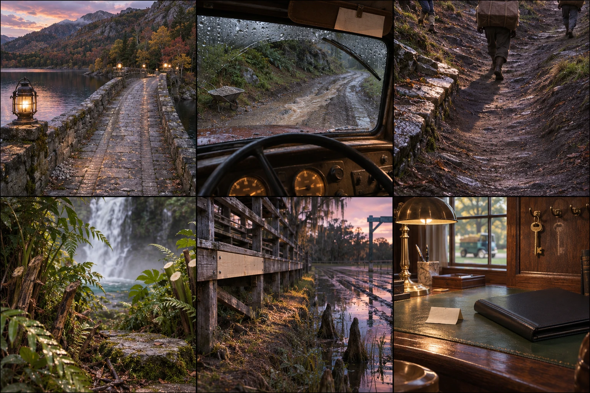

# One Last Crossing · Where the six stories happen

Week 11 • Founder location interview and Inklings writing workshop • November 22, 2026

Jake selected where the first five encounters take place. For the sixth he selected Dr. Duckhook’s executive office and the reason for the meeting. David Babb comes to buy the golf course for The LLC’s investment portfolio. Zach Wilson refuses his offers. Jake asked the Inklings to develop the scene before choosing the spot where Zach delivers his final answer. Dialogue, props and cuts below are proposed manuscript. The Week 11 football outcomes still control the sporting endings.

Three modeled workshop desks developed this pass. The first tested whose decision changes each scene, the second wrote the Jackson negotiation, and the third tested whether the place and its people remain recognizable across cuts. Their editorial choices below build on the [previous individual council notes](SIX_LOCATION_SUMMIT_SEAT_NOTES_2026-11-22.md), [six venue dossiers](SIX_MATCHUP_ATLAS_SUMMIT_2026-11-22.md) and [Week 10 physical page crosswalk](https://github.com/jakekaloper-hub/schemin-26/blob/51834dd03d8ccd182e11ca41fab71481a42afa7d/memo-os/week-10/production-evidence/completed-pdf-20261121/WEEK10_COMPLETED_PDF_RECEIPT_V1.json).

## Atlas addresses for production

All six sites use the existing Atlas location and sublocation resolver. The fixed landmark anchors the scene. The truck cab, spectators and temporary sporting equipment belong to the Week 11 staging. [Six scene records and three-layer notes](sets/location-bindings.json)

| Matchup | Parent venue | Feature within that venue |
|---|---|---|
| W11-G01 | `LOC-BRIDGE-MOUNTAIN-LAKE` | `STONE-BRIDGE` |
| W11-G02 | `LOC-SLOB-FOOTHILL-CAMP` | `HEARTHROAD-RUT` |
| W11-G03 | `LOC-TRADE-JEDI-MOUNTAIN-BASE` | `FOOT-OF-THE-EASTERN-ASCENT` |
| W11-G04 | `LOC-TDS-WATERFALL-TEMPLE` | `FALLS-VEGETATION-BREAK` |
| W11-G05 | `LOC-MUD-DOGS-SWAMP` | `GATORS-DAWGS-SIGN` |
| W11-G06 | `LOC-COUNTRY-CLUB-JACKSON` | `EXECUTIVE-OFFICE` |

The full address follows `SUB::<parent venue>::<feature>`. Use the existing stone bridge with midspan specified in the scene record. The executive office also has its own 3D study. The four other feature addresses are newly registered in this pass.

## Twelve seasons on six sets

Jake wants the places to feel as thoroughly inhabited as the world in *Red Dead Redemption 2*. The Commonwealth is playing its twelfth season. For Week 11, let the reader catch someone using each place in a way a first-time visitor would miss. Photograph that little piece of local knowledge in the pink, violet and aqua light of the GTA VI issue.

Read the study across each row. The six photographs are AI-generated art-direction proposals. Use them for materials, light and scale. Take the bridge’s width and lamp spacing from physical page 33, the swamp entrance from page 17, and the Jackson room layout from the office model. In the bridge master both lake edges must show. At the swamp gate the pictured insert is framed low enough to study the stands. The identifying wide must include the arched overhead board. [Finished Week 10 PDF receipt and physical-page crosswalk](https://github.com/jakekaloper-hub/schemin-26/blob/51834dd03d8ccd182e11ca41fab71481a42afa7d/memo-os/week-10/production-evidence/completed-pdf-20261121/WEEK10_COMPLETED_PDF_RECEIPT_V1.json)

**Mountain Lake Bridge.** Two wheel tracks polish the intact center stones. One reset stone catches the lantern because its face is still rough. Before Wilson and Austin meet, a carter waits back at the approach. Just before the duel, the last wheel across that stone gives a brief rattle. The waiting carter is the first to notice how long the lake stays quiet after the fall. Keep the same lantern beside it in the reverse. When Wilson fills the travelers’ usual line and Austin holds his place, even a reader who has never seen these two understands what everyone is waiting for.

**Hearthroad.** The road crew has packed pale gravel into the shoulder. The first white chip Jordan sees moving across the rut tells him the patch is washing out again. The audience learns the depth of the water by watching that chip. Jordan catches the curling delivery slip under the visor without taking his eyes off the windshield. Manning has been watching the water uphill. When Jordan turns back to the radio, stay at the windshield for one more sweep. Another chip goes. Match the sheltered kegs and canvas on physical page 35.

**Foot of the Eastern Ascent.** There’s a hollow in the path where people climbing with a load take the shorter inside turn. When a porter approaches, the uphill spectators open a gap without breaking off their conversation. Brandon, looking up at the crowd that laughed at him last week, mistakes the movement for a better view of himself. Then the parcel goes through. Let him have that private laugh. The damp path catches a low stripe of sky behind his hat. The residents close ranks again while Jake is still playing to them. Place any battle damage only where the Week 10 image supports the sightline.

**Waterfall Temple boundary.** The oldest clipped stems have gone grey. This week’s pale cuts are all on the path side, just wide enough for a person carrying something. A local with a basket pauses on the one dry stone to shift the load, then carries on. From farther back Kevin’s greeting disappears under the falls. When Phillip makes room for him on that stone, they can finally hear each other. Shoot toward the spray, with the visitors’ path visible and the household off camera. The opening works for either sport. Give the drying stone and the continued drip their own beat after the competitors leave.

**Gators & Dawgs sign.** The finished page 17 has empty raised stands on the left, flooded racing scars below, and a weathered overhead board reading **THE SWAMP DECLARES A BLOCKADE**. The small Cancún card hangs on the right post. Keep all four in their original relationship. Try one pale replacement plank low in the stands, where it would be stepped on first. Ben’s headlights catch a bright wet streak below it. Bobby walks the narrow, dull strip alongside the water and waits for Ben to notice where his paws stayed dry. Ben kills the high beams to see what Bobby sees. The postcard can still flutter when the truck goes quiet.

**Jackson executive office.** Staff borrow a course key from a brass hook beside the desk. The finish has worn through directly below it. In the minute before David opens his folio, a groundskeeper returns the key. Zach acknowledges the return without interrupting David. The visitor politely moves his folder to clear the usual landing place. On his second offer, let his eyes go back to that hook when Zach asks who would control the locks. The clean edge of the folio catches the lamp. The grass crew goes on working outside. That beat plays at the desk, window or door and gives David a genuine reason to reconsider what he is asking Zach to sell.

The new repairs, errands, key and background performers are proposed set dressing. The finished Week 10 edition supplies the older pictured conditions. Individual objects have no assigned founding year. For a return visit, carry forward the surface that survives the scene and update the moving part, such as the gravel after rain or the key when it is signed out. Keep the same visible detail in a close shot, its reverse and any phone crop that uses it.

## D0nkey K0ng and His Majesty’s Blood · Midspan

**Founder choice.** An intense, carefully choreographed duel at the midpoint of the narrow Mountain Lake Bridge. Lake visible on both sides. Wilson Look is the brute fighter. Austin Byars carries himself with the composure of a samurai. Keep their established bodies, clothing and belt.

**Opening.** Start where physical page 33 left them, facing each other from opposite ends. Get to midspan in the first sequence. The deck looks long in the establishing photograph. Seen across its width, with water on either side of the four-legged Arsenal centaur, it looks startlingly small. Wilson makes the first deliberate move onto the center stones. Austin gives his cloak a moment to settle. Wilson had expected him to hurry.

**The turn.** Let Wilson enjoy the noise he draws out of the bridge. Then give Austin a sustained close-up. The noise dies, the two are still at midspan, and Austin has held Wilson’s attention for the whole silence. In the next wide, the duel is fully underway. Preserve the position of the repaired parapet from shot to shot so that a change in rhythm reads as character. A sweep of violet on the stone and aqua water at both edges can sell the height without an explanatory caption.

### The last strike at Mountain Lake

**Founder direction.** The verified winner delivers a violent, nearly fatal final strike at midspan. The blow sends the loser clear of the bridge and into Mountain Lake. The winner stays above. The loser breaks the surface alive and makes for shore. The water separates them for the last time in this story.

**If His Majesty’s Blood wins.** Austin has been still long enough for the carter to hear Wilson breathing. His last strike ends that stillness. All four of Wilson’s hooves leave the stone. From the approach, the carter can see straight through the place the great Arsenal centaur occupied a moment ago. The lake closes over the red and gold. Austin goes to the parapet. Long enough passes for him to take out the jester’s cap he had made and stand there with the speech dying in his throat. Then Wilson breaks the surface and draws one ragged breath. Austin lets the cap fall beside him. “My jester,” he says, so quietly only the carter hears. Wilson takes the cap in one fist and turns for shore. Austin walks off the other way. Whether Wilson ever answers the appointment belongs to another week.

**If D0nkey K0ng wins.** The force of Wilson’s final blow carries Austin bodily over the parapet. One instant the deck lantern picks out the gold of his belt. In the next, the light falls on bare stone. Wilson waits for the dark hood to come up. A strip of crimson floats to the surface and lies there. For the first time in the duel, Wilson looks to the carter as if a stranger might know what to do. Then comes a cough from well beyond the cloth. Austin is alive, swimming away from the span. The carter sees Wilson’s shoulders drop before he turns to leave. Austin keeps his belt. No cap appears in this ending.

**Closing photograph.** Return to the Week 10 side view of the intact span. Use the same midspan lantern to place the small figure on deck, already walking away. Below it, the survivor’s wake leads toward shore. Keep the lake and both figures legible at phone size. End the bridge feature on that separation. If ESPN has yet to decide the game, hold the draft at midspan. An official tie ends there with both characters still on the bridge. [Earlier owner workshop and subsequent Founder revision](OWNER_VICTORY_CODAS_2026-11-22.md)

## Slob on my Dobb and El Niño · Inside the cab at Hearthroad

**Founder choice.** Jordan Hollingshead is in the truck cab at the edge of Hearthroad, watching the rut fill. Physical page 35 placed the beer under shelter. Open through the windshield and keep any visible cargo consistent with that handoff.

**Opening.** The wiper gives Jordan one clear look at a rut he has driven past often enough to stop noticing. On the next sweep he can see water moving across it. He puts his hand on the radio. Before he speaks, Manning Welty asks through the partly open window, “What time did you tell them?” Jordan answers automatically. Then he hears himself name a time he may already have missed.

**The turn.** In the reverse, Manning watches the truck’s stationary wheels. It matters to him that the man who drove through last week’s blockade has stopped of his own accord. Back inside the cab, the dashboard lights Jordan’s knuckles amber. Outside, a pink tail lamp breaks apart in the violet water. The audience should be able to tell where the rain is going and why Jordan is still sitting there.

**After the result.** If Jordan wins, let him make the call that gets the delivery through and show what arriving cost him. If Manning wins, Jordan still acts responsibly. His last line can be the honest delay he radios to his customer. If tied, leave the promised time spoken and the departure unresolved.

## ObiWan Jacoby and The Chili Cheesers · Foot of the Eastern Ascent

**Founder choice.** Jake Kaloper and Brandon Pryor meet at the foot of the Eastern Ascent with the spectators above them. Jake’s later press interview has its own mountain shack setup.

**Opening.** A cheer comes down from the rise. Brandon tips the hat he could not reach at the end of last week’s rodeo. Jake looks up at the same instant. Each thinks the cheer might be for him. The first photograph from ground level makes the spectators look imposing. The reverse from the rise shows how little those people can actually see of Brandon’s expression.

**The turn.** Give Jake the public laugh he wanted. When he looks up for another, Brandon keeps watching him. Try letting Brandon say, quietly enough that only Jake can hear, “I was down here last week, too.” Stage the stylized confrontation in the ground they now share. The green light belongs to Jake’s defensive saber. A spectator checking for the absent House line provides the small background joke. The proposed preseason protection and Jake’s accusations get space later under the lamp at the shack.

**After the result.** A Jake win earns an instant of visible relief before the boasting starts again. A Brandon win earns him the choice to put on his hat and walk away while the crowd is still calling. A tie leaves the two men with a better understanding of what it costs to be watched. A loss alone does not mathematically eliminate Jake.

### Brandon Pryor’s Wolf Brand Chili scene

Brandon asked for Wolf Brand Chili all over ObiWan Jacoby’s head and body in this matchup. Play it after Jake earns the first laugh, before the official result. The dialogue and the choice of No Beans are the Inklings’ and production’s interpretation of his request.

The porter clears the turn. Jake has just made the uphill crowd laugh about Brandon’s rodeo hat. He looks back for a second laugh. Brandon lays the hat crown-up on a dry stone. Beside it sits an empty red **WOLF BRAND CHILI** can, its blue **NO BEANS** band facing the path. Jake spots the camp pot.

**Jake** — “You bring enough for everybody?”

**Brandon** — “I counted one.”

Brandon tips the pot. Chili lands in Jake’s blond hair, folds over both shoulders and runs down his jacket and robes to his boots. Stay on the two of them as Jake wipes one eye. His sleeve leaves a fresh streak across his cheek. He holds out a hand toward the only clean thing within reach.

**Jake** — “Hand me the hat.”

Brandon slides it six inches farther away. This time the laugh comes from the people close enough to see his hand.

[Open the inspected 1080 × 1920 scene board](sets/Schemin-W11-G03-Wolf-Brand-Chili.png)

**Native PNG review.** The Week 10 *No Private Exit* PNG shows Brandon in the mud, his black hat with a red band lying just beyond his reach. That distance gives his six-inch movement a history readers can see. *The Price of Quiet* PNG shows Jake’s earth-tone layers and green blade at the snowy home approach. Keep that location distinct from the turn where the porter passes. The Week 11 six-site PNG study shows the working footpath in its upper-right panel. The 1080 × 1920 owner-interview PNGs put Jake and Brandon together below the audience. The new board uses the two Week 10 image crops and the supplied can detail. It is a production manuscript board. The completed Week 11 pour still needs its own illustrated frame and visual review.

**Production coverage.** Give the label one readable insert while the can is still clean. A full pot and the emptied tins account for the quantity. Use the red can and stacked white wordmark from Brandon’s reference. The left-hand 15 oz No Beans can is the selected prop. Composite the lettering and check it at 390 px. For the pour, hold a foot-of-the-ascent wide with the spectators above both men, then a reverse that shows the back of Jake’s robes and both boots. Keep the chili reddish brown with recognizable food texture, Jake’s eyes readable, and his retriever clear. Carry the same chili streaks through the public ending. The green saber belongs to the established duel. The missing House line remains a background beat.

**Result and aftermath.** If Jake wins, let his shoulders drop in relief before he faces the bank in soaked robes. If Brandon wins, he retrieves the clean hat, puts it on and walks out below the crowd. A tie reopens the footpath for the next porter. The pending-score layout can hold on the approach and first laugh. Reserve the reporter, clipping and proposed clause for the later shack interview. This is a Week 11 wardrobe condition at the public encounter. The [Week 9 cookout](../week-9/Week_9_Approval_Review_Full_Names.md#19-who-gets-served) used a wheeled vat and ladle salute. Here Brandon gets the last laugh by moving his hat.

## Red Leopards and Three Dreaded Snake · The break in the vegetation

**Founder choice.** Kevin Zeek meets Phillip Pitts at the break in the vegetation near the falls, on Phillip’s outer property line. The sport remains open.

**Opening.** Kevin calls his greeting from the path. The water swallows the last few words. Phillip waits until Kevin comes through the leaves. For the second attempt Kevin has to use his ordinary voice. That loss of a grand entrance costs him a little of the easy victory he was expecting. Frame the break low enough to glimpse the falls behind it. The host, visitor and temporary marker should all be visible without showing the household courtyard.

**The turn.** Phillip gives Kevin first choice of sides. Now Kevin has to inspect the ground he has just implied is beneath his concern. Try that beat in two sports. In a short boundary race the vegetation briefly hides the apparent leader, making Kevin’s look at the reappearance meaningful. In tug-of-war the same wide can hold both faces when the bravado slips. Produce a clean location proof with the marker alone until the sport is chosen.

**If Red Leopards wins · The hat he packed.** Show the finish of the chosen sport first. At Phillip’s outer boundary, Kevin unrolls a dry bag, puts a sun-faded Florida python-hunter cap between his spotted ears and pulls on a mesh field vest over his armor. A little headlamp rides the brim. The brim takes its first drop of spray while Phillip is looking at it. Phillip takes in the outfit. “When did you pack that?” Kevin turns the brim square to the camera. “Tuesday.” After a beat, he makes room for Phillip on the dry stone. Phillip steps in beside him on his own terms.

**Photograph.** It looks like a sportsman’s victory portrait. The red muzzle and black rosettes read before the field vest. Give the cap patch a small Florida outline and a coiled-python emblem. Set the host and visitor side by side with all three of Phillip’s heads visible on his one armored body. The damp finish marker and spray place the picture at the Commonwealth falls. The fun is discovering Kevin packed an entire outfit on the assumption he would win.

**Other results.** If Phillip wins, Kevin recognizes the finish first and Phillip gives him the choice of the dry footing for the walk back. A tie or pending result holds both at the marker. Kevin’s bag stays shut. The sport is still open, as is the choice among three winning photographs in the [owner notes and Bullpen workshop](OWNER_VICTORY_CODAS_2026-11-22.md).

## Mud Dogs and Seven Deadly Chins · The Gators & Dawgs sign

**Founder choice.** Ben Whipple first has to trust Bobby Mitchell at the old Gators & Dawgs sign, exactly where the departing truck left Bobby on physical page 17.

**Opening.** Come in at vehicle-window height from Ben’s side. He already has a line ready about anybody who needs directions in his own swamp. The overhead letters catch his headlights. Below them, Bobby has stopped on the last patch of firm ground. One paw is still dry. Ben looks down from the sign and lets the remark go. Match the arch, right-hand postcard and left-hand stands to physical page 17.

**The turn.** Where Ben sees a straight approach, Bobby sees soft footing. Bobby has every reason to take the advantage and every right to leave Ben to figure it out. He gives him a warning anyway. Shoot Ben going back to look from the same low angle that made Bobby look abandoned last week. One man chose fairness. The other had to be willing to look foolish in order to accept it. A thin pink reflection in the puddle can pick out the letters while the churned bank still reads brown.

**After the result.** If Bobby wins, give Ben a real question about where he lost time. If Ben wins, let Bobby finish speaking before the competition or the verified-elimination Cancún coda takes the page. If tied, the sign remains where it was and the math needs another look. The nature of the contest can stay open while this exchange goes to storyboard.

## Dr. Duckhook and The LLC · The executive office at Jackson

**Founder choice.** The meeting is inside Dr. Duckhook’s executive office in the Country Club of Jackson clubhouse. David wants to buy the golf course and add it to The LLC’s portfolio. Zach refuses every offer. That refusal holds through a win, loss or tie. The final spot in the office remains an editorial choice for comparison.

[Editable 3D office set with three cameras](sets/jackson-executive-office/jackson-executive-office.glb) · [Atlas parent and office handle](../../world/location-control-plane/locations/LOC-COUNTRY-CLUB-JACKSON/CARD.json)

**What changes when David comes in.** In Week 10, David left his chair, went up Jake’s mountain and put up 203.96. Here he takes the visitor’s chair. Zach was made the punch line at his own birthday. This week somebody has to wait until he’s finished speaking. Let the ordinary business of the club carry on beyond the door through the entire conversation. The course means work, habits and people to one man. To the other it is a property valuable enough to want.

**First offer.** David lays his folder down and waits for Zach to open it. A groundskeeper returns the key. David shifts his folder out of the way and Zach gives the groundskeeper a nod. Try this exchange before revealing any paperwork.

> **David:** “I’d like to buy the course.”
>
> **Zach:** “I heard you. What made you think I’d sell it?”
>
> **David:** “I figured you’d at least look.”
>
> **Zach:** “I look at it every morning.”

**Why he tries again.** David takes the answer seriously enough to change the offer, but he has misheard the objection. He proposes acquiring the course while keeping Zach in charge of day-to-day operations. That concession sounds generous to David. To Zach it turns his own job into something a visitor has the power to give him. Have David open the folder himself this time. Zach needs only one question.

> **David:** “You’d still run the place.”
>
> **Zach:** “Who do I call when I want to change the locks?”

Give David time to consider the truthful answer. An offer price would let the audience argue about the number and miss the change in their relationship. A Week 10 clipping can sit folded in his folio. Pull it from the scene if it competes with the unsigned offer.

**Three photographs for the last no.** At the **desk**, Zach closes the folder and leaves David’s chair where it is. “No. You can stay for coffee, though.” Hold on David deciding whether to sit. At the **window**, catch David looking at the course through Zach’s reflection. Zach turns back toward his guest before answering, with the unsigned offer still on the desk. At the **door**, Zach hands David the folder as a member of staff waits to speak with him. The public cost of the failed pitch lands on David. The room’s preferred first proof is the desk because Zach gets to refuse the acquisition without dismissing the person. Jake has not selected that ending.

**Look and outcome.** The office lamp motivates a warm pool of light on the offer. Cool window light can hold the far side of David’s face, with the common violet in the shadows. Keep the club’s visible environment consistent with its Atlas plate. In a Zach win, he can turn back to club business while David considers the coffee. In a David win, Zach can congratulate him on the game. Let David wait one hopeful beat for a change of mind and hear only the congratulations. In a tie, both leave with the sporting question open and the ownership question answered. Keep the course in Zach’s hands in every version.

**Three-layer set record.** The registered parent is `LOC-COUNTRY-CLUB-JACKSON`. The office sits within the existing clubhouse and uses `SUB::LOC-COUNTRY-CLUB-JACKSON::EXECUTIVE-OFFICE`. Physical access inherits the club’s Jackson Levee context. The desk, guest chair, door and proposed course-facing window are local set geometry. Socially, this is where Zach receives staff and visitors and can decline an unsolicited buyer. Historically, the Founder identified this as the longstanding venue requested in the eleven-year brief. Its exact construction year, renovations, finishes and past meetings have no dated source. The 3D model is a cutaway for testing eyelines and coverage. It has no surveyed dimensions or approved photographic likeness.
