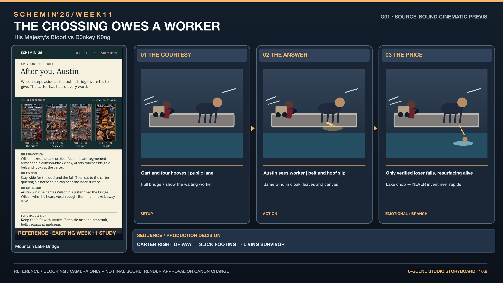
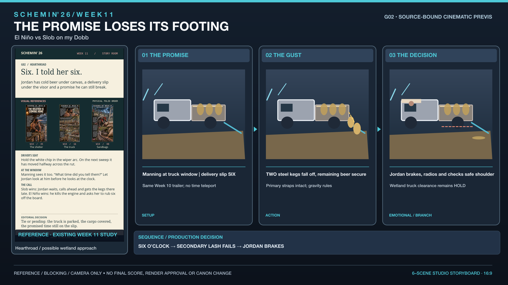
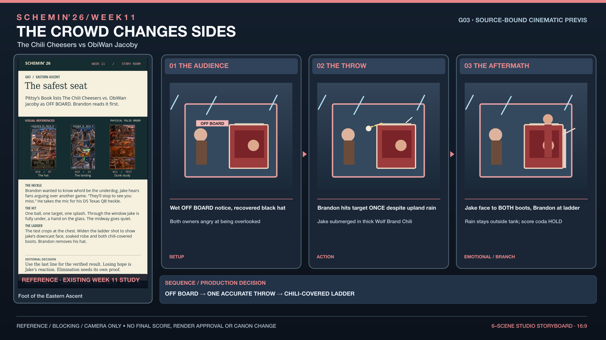
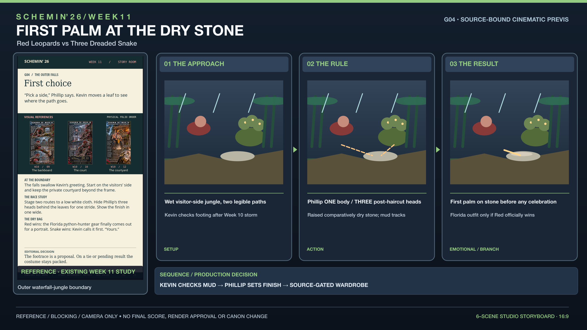
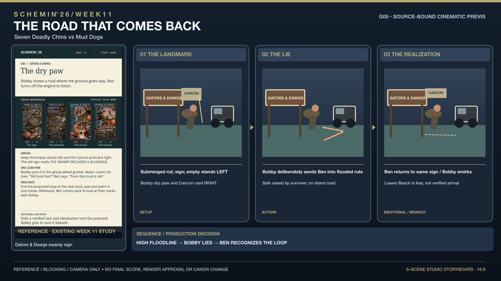
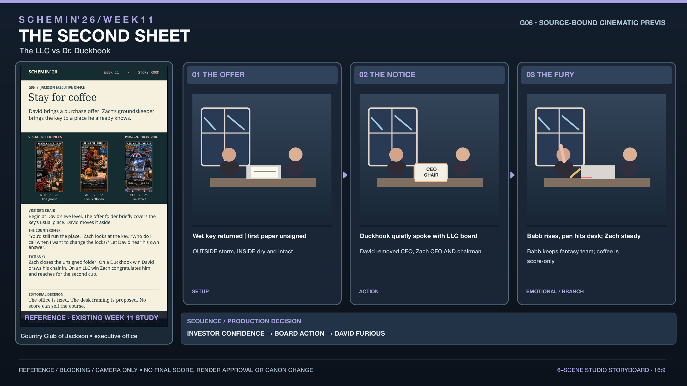

# Week 11 — Six cinematic storyboards, source-backed visual preproduction
**Six 2560 × 1440 landscape three-shot storyboard sheets. NOT the 1080 × 1920 final memo folios.**

Each sheet places the existing original Week 11 visual study at left and three symbolic blocking diagrams for **setup → owner-controlled action → consequence**. These are camera and performance/prop diagrams, not final production photography, independent approval or official football results.

The twelve production discipline names below refer to published-method reference lenses. No actual filmmaker participated or signed off. [All 35 folio visual leads and department acceptance](../W11_12_PRODUCTION_LEADS_VISUAL_OWNERSHIP_2026-11-23.md) · [All 35 detailed shots](../W11_ALL_35_VISUAL_DIRECTOR_SHOT_SPECS_2026-11-23.md).

## G01 · His Majesty’s Blood at D0nkey K0ng
**Folios:** F09–F11 · **Lead discipline:** Doug Chiang / production design · **Locked source/conditional restrictions:** Rain-slick bridge, carter witness, winner-specific living survivor; no imaginary river rapids.

[Full-size 2560×1440 storyboard](W11-G01-CINEMATIC-SHOTBOARD-PREVIS.png)

## G02 · El Niño at Slob on my Dobb
**Folios:** F12–F13 · **Lead discipline:** Dylan Cole / environment design · **Locked source/conditional restrictions:** 6 o’clock beer promise, secondary tie failure and TWO falling kegs. Truck route remains source-gated.

[Full-size 2560×1440 storyboard](W11-G02-CINEMATIC-SHOTBOARD-PREVIS.png)

## G03 · The Chili Cheesers at ObiWan Jacoby
**Folios:** F14–F16 · **Lead discipline:** Doug Chiang / production design · **Locked source/conditional restrictions:** Rainy public carnival, Brandon’s ONE throw, submerged Jake, full chili-coated ladder reveal.

[Full-size 2560×1440 storyboard](W11-G03-CINEMATIC-SHOTBOARD-PREVIS.png)

## G04 · Red Leopards at Three Dreaded Snake
**Folios:** F17–F18 · **Lead discipline:** Dylan Cole / environment design · **Locked source/conditional restrictions:** Saturated waterfall jungle, Phillip one body/three heads, Kevin’s muddy choice, dry stone and conditional outfit.

[Full-size 2560×1440 storyboard](W11-G04-CINEMATIC-SHOTBOARD-PREVIS.png)

## G05 · Seven Deadly Chins at Mud Dogs
**Folios:** F19–F20 · **Lead discipline:** Dylan Cole / environment design · **Locked source/conditional restrictions:** Exceptionally flooded swamp, Bobby’s INTENTIONAL lie, Ben’s return loop and Cancún card.

[Full-size 2560×1440 storyboard](W11-G05-CINEMATIC-SHOTBOARD-PREVIS.png)

## G06 · The LLC at Dr. Duckhook
**Folios:** F21–F22 · **Lead discipline:** Frank Masi / unit stills · **Locked source/conditional restrictions:** Jackson external squall, dry office, Babb investor confidence and Zach’s fixed board reversal.

[Full-size 2560×1440 storyboard](W11-G06-CINEMATIC-SHOTBOARD-PREVIS.png)

## Visual acceptance and handoff
- After each shot diagram, production must verify actual original character reference bytes, registered location/cinematic plate, material/lighting and live source status before final image generation.
- The existing 35-folio tldraw page remains the operational visual review board. Six storyboard PNGs were created as portable source-backed visual planning files; **they have not been imported into tldraw** unless a later live-editor receipt confirms so.
- The final product is **one native 1080 × 1920 PNG per published folio**, independently inspected at native and 390px phone scale, not this landscape storyboard sheet.
- Reproducible generator: python3 memo-os/week-11/preproduction/visual-previs/render_storyboards.py (requires system rsvg-convert; uses existing tracked native board study PNGs and local fonts, distributes no font files).
- Current sports results, source/atlas release gates, and final page count are not determined by storyboard imagery.

**Import target:** [Week 11 six-image idempotent tldraw gallery import manifest](../W11_TLDRAW_SIX_STORYBOARD_IMPORT_PLAN_2026-11-23.json) — verified source PNG bytes, exact persistent shape IDs and page ID, but **not live-import verified**. [Librarian VisualLibraryStaff specialty, Bullpen draft PR #176](https://github.com/jakekaloper-hub/bullpen/pull/176) contains the reusable skill and read-only preflight. The connected editor must actually acknowledge image/asset IDs and a readback before this becomes SAVED.
